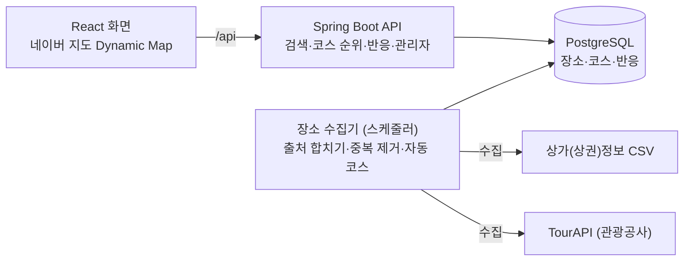

# 데이트코스 추천 서비스 기획안

2026-10-28 · 원본: Claude 문서 https://claude.ai/artifact/8QE1oMKHLJpiexu595bV3R (이 파일은 그 내보내기)

## 한 줄 소개

**지역과 분위기만 고르면, 순위가 매겨진 데이트 코스와 근처 식당·카페를 지도에서 바로 보여주는 웹 서비스**입니다. (주소: date-course.kimseongmin.co.kr, 이름은 가칭)

- 예: 강남 + 조용 → 별마당도서관 → 소품샵 → 카페 → 식당

**만드는 이유**: 데이트 코스는 장소를 찾고, 동선을 맞추고, 식당·카페를 고르는 일이 겹쳐서 짜기 힘듭니다. 이미 짜인 코스를 순위대로 보여주면 사용자는 **찾는 대신 고르기만** 하면 됩니다.

## 대상 사용자

네 부류를 대상으로 하고, 부류마다 자주 고를 키워드가 다릅니다. 첫 화면에서 "누구와"를 고르면 키워드를 미리 추천해 줄 수 있습니다.

| 대상 | 주로 찾는 것 | 미리 골라 줄 키워드 |
| --- | --- | --- |
| 커플 (일상) | 새로운 장소, 부담 없는 예산 | 활동적, 저예산 |
| 소개팅 | 대화하기 좋은 곳, 짧은 코스 | 조용, 실내 |
| 기념일 | 분위기 있는 식당, 야경 | 로맨틱, 고예산 |
| 친목 (친구 모임) | 여럿이 즐길 거리, 넓은 자리 | 액티비티, 단체 |

## 사용 흐름

로그인 없이 다섯 단계로 코스까지 도착합니다. 저장·좋아요는 브라우저마다 만드는 방문자 id(힐링룸과 같은 방식)로 구분합니다.

1. **지역 선택**: 지도를 옮기거나 누르거나, "강남역"처럼 검색하거나, "내 주변"(위치 권한)으로 고릅니다.
2. **키워드 1~3개**: 누구와(선택)를 고르면 키워드를 미리 골라 줍니다.
3. **코스 순위 목록**: 왼쪽은 순위 카드(코스 이름, 단계 요약, 걸리는 시간, 예산), 오른쪽 지도에는 고른 코스의 장소가 번호 핀으로 박힙니다.
4. **코스 상세**: 동선 지도(단계를 잇는 선 + 걸어서 걸리는 시간), 단계별 장소 카드, 단계마다 **근처 대안**(식당·카페 3~5곳)을 바꿔 끼울 수 있습니다.
5. **저장·반응**: 저장, 좋아요, "다녀왔어요"를 누르면 순위에 반영됩니다. 장소를 누르면 네이버지도 원본 페이지로 갑니다.

## 기능 목록

MVP는 "지역 + 키워드 → 코스 순위 → 상세"를 전국에서 돌게 하는 데까지입니다. 나머지는 사용자 반응이 쌓인 뒤에 붙입니다.

| 기능 | 단계 | 비고 |
| --- | --- | --- |
| 지도에서 지역 고르기, 지역 검색, 내 주변 | MVP | 네이버 지도 Dynamic Map (무료 이용량 안에서만) |
| 키워드 1~3개 선택, 누구와 선택 | MVP | |
| 코스 순위 목록 + 지도 핀 | MVP | |
| 코스 상세: 동선, 단계별 장소, 근처 식당·카페 대안 | MVP | 대안으로 바꾸면 동선 다시 계산 |
| 코스 자동 조합(큐레이션 없는 지역) | MVP | 전국 범위라 필수 |
| 저장·좋아요·다녀왔어요 | MVP | 방문자 id 기준, 순위에 반영 |
| 관리자: 큐레이션 코스 등록·수정, 장소 키워드 달기 | MVP | 힐링룸과 같은 로그인 + 관리자 키 |
| 코스 공유 링크, 카카오톡 미리보기 | 나중 | |
| 예산·시간대(낮/저녁/밤) 필터 | 나중 | 영업시간 데이터 필요 |
| 날씨 반영(비 오면 실내 코스 위로) | 나중 | 기상청 단기예보 API |
| 내가 짠 코스 올리기(사용자 코스) | 나중 | 욕설 거르기 필요 |
| 코스 설명·키워드 분류를 LLM으로 | 나중 | 후보 장소 안에서만 고르게 |

## 키워드 체계

키워드는 네 분류에서 합쳐 1~3개를 고릅니다. 장소와 코스 모두에 같은 키워드를 달아 맞추고, 장소 키워드는 카테고리로 자동으로 붙인 뒤 관리자가 고칩니다.

| 분류 | 키워드 (초안) | 고르는 방법 |
| --- | --- | --- |
| 분위기 | 조용, 로맨틱, 활기찬, 감성, 이색적 | 여러 개 |
| 활동 | 산책, 전시·문화, 체험·공방, 쇼핑, 액티비티, 야경, 맛집 투어 | 여러 개 |
| 실내외 | 실내, 야외 | 하나 (안 고르면 상관없음) |
| 예산 (2인 기준) | 3만원 이하, 3~7만원, 7만원 이상 | 하나 (안 고르면 상관없음) |

예산 구간 금액은 초안이고, 장소별 가격 데이터가 API에 없어서 처음에는 큐레이션 코스에만 달 수 있습니다.

## 데이터와 순위 규칙

장소는 두 출처에서 모아 하나로 합치고, 순위는 **큐레이션 + 사용자 반응**으로 매깁니다. 전국을 사람이 다 큐레이션할 수는 없으므로, 큐레이션이 없는 지역은 코스를 자동으로 조합합니다.

### 출처

| 출처 | 쓰임 | 알아 둔 제약 |
| --- | --- | --- |
| [소상공인 상가(상권)정보](https://www.data.go.kr/data/15083033/fileData.do) (공공데이터포털) | 기본 장소 후보: 전국 카페·음식점·소매점(소품샵 등)의 상호, 업종, 주소, 좌표 | API가 아니라 CSV 파일을 분기마다 받아 넣음. 무료, 이용 제한 없음 |
| 한국관광공사 TourAPI (공공데이터포털) | 관광지·문화시설 설명과 사진, **여행코스** 데이터(자동 조합의 밑바탕) | 개발 계정은 하루 호출 수 제한 (기억 기준, 확인 필요) |

**무료로만 운영합니다.** 그래서 아래 둘은 쓰지 않습니다.

- **카카오 API**: 2026년 7월 21일부터 카카오맵 API 무료 쿼터는 계정의 첫 번째 앱에만 주어지고, 그 밖에는 결제 수단(비즈월렛)을 연결해야 합니다.
- **네이버 검색 API**: 2026년 7월 말 개발자센터 신규 신청이 닫혔고, 옮겨 간 NAVER API HUB는 유료화가 예고됐습니다. 네이버지도 링크는 API 없이 검색 주소로 겁니다.

지도 화면은 **네이버 지도 Dynamic Map 하나만** 무료 이용량(대표 계정 1개에 한해 월 6,000,000건) 안에서 씁니다. 넘으면 바로 과금되므로 네이버 클라우드 콘솔에서 이용 한도를 그 이하(5,000,000건)로 걸어 둡니다.

네이버·카카오 지도의 **리뷰·별점을 긁어 오는 것은 약관 위반**이라 쓰지 않습니다. API 결과를 DB에 얼마나 오래 두어도 되는지는 각 약관을 확인해야 합니다.

### 중복 제거

1. 이름을 정리합니다: 공백·괄호·기호를 빼고, "강남점" 같은 지점명은 따로 둡니다.
2. 정리한 이름이 같고 좌표가 50m 안이면, 또는 전화번호가 같으면 같은 장소로 봅니다.
3. 장소는 하나로 두고, 출처별 id(상가정보 상가업소번호, TourAPI contentid)는 따로 저장합니다.
4. 애매한 쌍(이름은 비슷하지만 50~150m)은 관리자 화면에 모아 사람이 합칩니다.

### 코스 만들기

- **큐레이션 코스**: 관리자가 단계별 장소와 키워드를 직접 등록합니다. 사람이 많이 찾는 지역부터 채웁니다.
- **자동 코스**: 중심 장소(관광명소·문화시설·TourAPI 여행코스) 하나를 고르고, 걸어서 갈 만한 거리 안의 장소·카페·식당을 붙여 3~4단계로 만듭니다.

### 순위 점수 (초안)

순위는 아래 다섯 항목을 합친 점수입니다. 가중치는 운영하며 조정합니다.

| 항목 | 내용 |
| --- | --- |
| 키워드 일치 | 고른 키워드와 코스·장소 키워드가 겹치는 비율 |
| 큐레이션 | 관리자가 등록한 코스면 기본 가산점 |
| 사용자 반응 | 다녀왔어요 > 저장 > 좋아요 순으로 무겁게, 최근 90일 반응을 더 무겁게. 한 방문자는 코스당 한 번만 |
| 동선 | 단계 사이 걸어서 걸리는 시간이 짧을수록 가산 |
| 출처 일치 | 상가정보와 TourAPI에 모두 나오는 장소가 많을수록 가산 (폐업·없는 장소 걸러내기) |

## 화면 목록

화면은 여섯 개입니다. 검색 결과와 코스 상세는 모두 지도에 장소 핀이 박힌 화면이고, 휴대폰에서는 지도 위에 목록이 아래에서 올라오는 서랍으로 보입니다.

| 화면 | 주소 (초안) | 보여주는 것 |
| --- | --- | --- |
| 홈 | `/` | 지역 검색창, 내 주변 버튼, 누구와·키워드 칩, 인기 지역·이번 주 인기 코스 |
| 검색 결과 | `/search?area=&kw=` | 왼쪽 코스 순위 카드, 오른쪽 지도(고른 코스 핀 + 주변 식당·카페 핀), 키워드 바꾸기 |
| 코스 상세 | `/courses/{id}` | 동선 지도, 단계별 장소 카드, 단계마다 근처 대안, 저장·좋아요·다녀왔어요 |
| 장소 상세 (패널) | 지도 위 패널 | 사진(TourAPI), 주소, 전화, 네이버지도 링크, 이 장소가 들어간 코스 |
| 내 저장 | `/saved` | 이 브라우저에서 저장한 코스 (로그인 없음) |
| 관리자 | `/admin` | 큐레이션 코스 등록·수정, 장소 키워드 고치기, 중복 후보 합치기 |

## 기술 스택과 데이터 모델

힐링룸과 같은 Spring Boot + PostgreSQL에 화면만 React로 바꿉니다. React 빌드 결과를 Spring Boot jar에 함께 넣으면 서버 하나로 배포할 수 있어 힐링룸 배포 방식을 그대로 씁니다.

| 영역 | 사용 기술 |
| --- | --- |
| 백엔드 | Java 17, Spring Boot 4.1, Spring Data JPA, 스케줄러(수집기) |
| DB | PostgreSQL 16 (새 DB), 수동 마이그레이션 |
| 화면 | React + Vite (TypeScript), 네이버 지도 JavaScript API v3 (Dynamic Map) |
| 배포 | GitHub Actions → ai-server, systemd, nginx |

화면은 우리 API와 네이버 지도만 부르고, 상가정보·TourAPI는 수집기가 불러 DB에 쌓습니다. 그래서 API 키가 브라우저에 나가지 않고 호출 한도도 아낍니다.

### 테이블 (초안)

| 테이블 | 담는 것 |
| --- | --- |
| `place` | 합친 장소: 이름, 좌표, 카테고리, 주소, 전화, 지역 |
| `place_source` | 출처별 id·링크 (sbiz, tour), 마지막 수집 시각 |
| `keyword` | 키워드와 분류 (분위기, 활동, 실내외, 예산) |
| `place_keyword`, `course_keyword` | 장소·코스와 키워드 연결 |
| `course` | 코스: 이름, 지역, 큐레이션/자동, 순위 점수 |
| `course_step` | 코스 단계: 순서, 장소, 단계 종류 (장소, 카페, 식당) |
| `reaction` | 방문자 id, 코스, 종류 (저장, 좋아요, 다녀왔어요), 시각 |

## 일정·운영

힐링룸과 같은 ai-server에 올리고, 주소는 **date-course.kimseongmin.co.kr**입니다. 날짜는 아직 정하지 않았고, 아래 순서로 진행합니다.

1. 기획안 확정, 화면 시안 (홈, 검색 결과, 코스 상세)
2. 저장소·뼈대: Spring Boot + React 프로젝트, AGENTS.md, DB 마이그레이션 V1
3. 장소 수집기: 상가정보 CSV·TourAPI 수집과 중복 제거, 관리자 중복 합치기
4. 코스: 자동 조합과 순위 점수, 큐레이션 코스 등록 (관리자)
5. 화면: 지도, 키워드, 순위 목록, 코스 상세
6. 배포: GitHub Actions, 서버 폴더, systemd, nginx, 인증서
7. 공개 전 큐레이션: 많이 찾는 지역부터 코스 채우기

운영 방식은 힐링룸을 그대로 따릅니다.

- 서버: 새 systemd 서비스, 포트는 힐링룸(18280)과 겹치지 않게 따로 정합니다.
- nginx: 이 주소 전용 `sites-available` 파일을 새로 만들고, 다른 서비스 설정 파일은 건드리지 않습니다.
- DNS: 가비아에 `date-course` A 기록을 추가합니다.
- DB: 같은 PostgreSQL에 새 DB와 전용 계정을 만들고, 스키마는 수동 마이그레이션(`ddl-auto=validate`)으로만 바꿉니다.
- Redis: 쓴다면 힐링룸처럼 전용 계정과 키 접두어를 둡니다.
- 배포: `main`에 푸시하면 자동 배포되고, 실패하면 이전 버전으로 되돌립니다.

## 아직 정할 것

- [ ] 서비스 이름 (주소는 date-course로 정해짐)
- [ ] 네이버 지도 콘솔 이용 한도를 월 5,000,000건으로 설정 (무료 이용량 월 6,000,000건)
- [ ] TourAPI의 호출 한도와 결과 저장 조건(약관) 확인
- [ ] 자동 코스의 "걸어서 갈 만한 거리" 기준 (예: 단계 사이 도보 15분)
- [ ] 동선·걸리는 시간 계산 방법 (직선 거리로 어림 vs 길찾기 API)
- [ ] 처음 큐레이션할 지역과 지역당 코스 수
- [ ] 예산 구간 금액
- [ ] 새 프로젝트를 runcat 저장소 안에 둘지, 별도 저장소로 나눌지
- [ ] 개인정보처리방침 (방문자 id, 위치 권한 사용)
