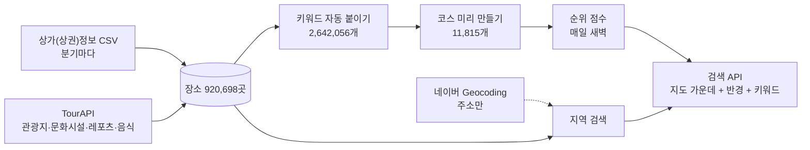

# 동작 방식

데이터를 어디서 가져와 어떻게 코스로 만들고, 검색할 때 어떤 순서로 보여주는지 적은 문서입니다.
숫자는 2026-10-29 운영 DB 기준입니다. 코드 위치와 운영 규칙은 [AGENTS.md](../AGENTS.md)에 있습니다.

검색할 때마다 밖에서 데이터를 가져오지 않습니다. 장소·키워드·코스·점수는 미리 만들어 DB에 두고, 검색은 그중 가까운 코스를 고르기만 합니다. 밖으로 나가는 호출은 주소 검색(Geocoding)과 화면의 지도뿐입니다.

## 1. 장소 모으기

| 출처 | 가져오는 것 | 방법 |
|---|---|---|
| 상가(상권)정보 (공공데이터포털) | 카페, 식당, 술집, 소품샵·서점·꽃집 등, 노래방·볼링장·게임장 등 | 분기마다 받는 시도별 CSV 16개(1.5GB). 키·이용 제한 없음 |
| TourAPI (한국관광공사) | 관광지(12), 문화시설(14), 레포츠(28), 음식점(39) + 사진·소개 | 수집기가 API 를 불러 받음(전국 약 40분) |

- 데이트와 상관없는 업종(병원, 편의점, PC방, 독서실, 유흥 주점 등)은 넣지 않습니다.
- **같은 장소 합치기**: 이름에서 공백·괄호·기호를 빼고 "강남점" 같은 지점명을 떼어 비교합니다.
  - 이름이 같고 50m 안 → 같은 장소 (출처만 더함). 둘 다 지점명이 있는데 다르면 다른 가게.
  - 이름이 같고 50~150m → 따로 두고 "중복 후보"로 모음(관리자가 판단, 지금 973쌍).
  - 관광명소는 관광명소끼리만 합칩니다(관광지 "인사동"과 가게 "인사동"이 합쳐진 적이 있음).
- 시도 이름은 공식 이름 16개로 맞춥니다(TourAPI 주소에 "경남", "광주광역사" 같은 표기가 섞여 있음).

| 분류 | 장소 수 |
|---|---|
| 식당 | 565,541 |
| 카페 | 156,030 |
| 술집 | 70,208 |
| 소품샵 등 | 57,524 |
| 놀거리 | 56,207 |
| 관광명소 | 12,526 |
| 문화시설 | 2,662 |

두 출처에 모두 있는 장소는 8,580곳이고, 이 장소들은 "실제로 있는 곳"으로 보고 순위에서 조금 위로 둡니다.

## 2. 키워드 붙이기

키워드는 네 분류 17개입니다.

| 분류 | 키워드 |
|---|---|
| 분위기 | 조용, 로맨틱, 활기찬, 감성, 이색적 |
| 활동 | 산책, 전시·문화, 체험·공방, 쇼핑, 액티비티, 야경, 맛집 투어 |
| 실내외 (하나만) | 실내, 야외 |
| 예산 (2인, 하나만) | 3만원 이하, 3~7만원, 7만원 이상 |

장소 키워드는 **확실한 것만** 자동으로 붙입니다. 모르면 붙이지 않습니다(엉뚱한 곳이 나오는 것보다 빠지는 게 덜 나쁨).

- **업종 규칙**: 상가정보는 업종 이름, TourAPI 는 분류 코드로 정합니다.
  - 노래방 → 액티비티·활기찬 / 파스타·스테이크 → 맛집 투어·로맨틱·7만원 이상 / 김밥·분식 → 3만원 이하
  - 미술관 → 전시·조용·감성 / 해변 → 산책·로맨틱·야외 / 전망대·다리 → 야경·로맨틱 / 공예 체험 → 체험·공방
- **이름 규칙**: 이름에 루프탑(야경·로맨틱·야외), 와인(로맨틱), 공방(체험·감성), 방탈출(액티비티·이색적), 북카페·책방(조용·감성), 갤러리(전시·감성) 같은 말이 있으면 더합니다.
- 실내외는 정해지지 않으면 관광명소는 야외, 나머지는 실내. 예산은 식당·카페·술집에만 붙입니다.
- 관리자가 직접 붙인 키워드는 자동으로 다시 붙일 때 건드리지 않습니다.

## 3. 코스 만들기

코스는 **구경 → (구경 하나 더) → 카페 → 식당**의 3~4단계입니다.

### 명소 코스 (9,602개)

1. **중심 장소**: 관광명소·문화시설 하나. 교통시설·학교·컨벤션·어린이공원·카지노와 이름에 연도가 든 지난 행사는 뺍니다.
2. **구경 하나 더**: 소품샵·서점(이름에 책방·서점·문고가 든 곳만)·다른 명소·볼링장·게임장·방탈출 등. 없으면 3단계로.
3. **카페**, 4. **식당**: 꼭 있어야 하고, 없으면 코스를 만들지 않습니다(산속 명소 등).

- **거리**: 단계 사이 직선 700m(걸어서 약 15분) 안, 모든 단계가 중심 장소에서 1km 안.
- **고르는 점수** (단계마다 후보 중 가장 높은 곳)

  | 항목 | 점수 |
  |---|---|
  | 모범음식점 등 공공기관이 지정한 곳 (`place_badge`) | +3 |
  | 중심 장소와 분위기 키워드가 겹칠 때마다 | +2 |
  | TourAPI 에도 있는 곳 | +2 |
  | 데이트에 어울리는 식당 업종 | 파스타·스테이크 +3, 경양식·일식·동남아 +2 … 국밥·분식 −2 |
  | 체인점 (아래 "체인 판별") | −3 |
  | 거리 250m 마다 | −1 |
  | 중심 장소와 같은 분류 (공원 → 공원) | −1 |
  | 이미 다른 코스에 넣은 횟수마다 | −0.7 |

  마지막 항목은 명소가 몰린 곳에서 모든 코스가 같은 카페로 가는 것을 막습니다(인사동의 한 찻집이 44개 코스에 들어간 적이 있음).
- **걸리는 시간**: 머무는 시간(명소 60분, 소품샵 30분, 카페 60분, 식당 70분 등) + 걷는 시간(직선 × 1.3 ÷ 분속 67m). 평균 약 4시간.
- **코스 키워드**: 구경 단계의 분위기·활동 + 카페·식당의 분위기, 실내외는 중심 장소, 예산은 식당을 따릅니다.

### 목적지 카페 코스 (1,406개)

관광공사(TourAPI)가 소개한 카페 2,982곳 중 절반이 명소 코스에 끼지 못해 어떤 코스에도 없었습니다(예: 울산 강동의 곽암아트카페갤러리). 그래서

- 관광공사가 소개하고 체인이 아닌 카페 중 명소 코스에 안 들어간 곳은 그 카페를 목적지로 **(근처 구경거리) → 카페 → 식당** 코스를 만듭니다. 구경거리는 없어도 되지만 식당은 있어야 합니다.
- 예: 강동사랑길 → 곽암아트카페갤러리 → 판지어촌계수산물구이단지
- 출처마다 이름이 달라 따로 들어간 같은 가게("곽암" 식당 = "곽암아트카페갤러리")는 50m 안에서 한 이름이 다른 이름을 품으면 같은 곳으로 보고 다시 고르지 않습니다.

### 동네 코스 (805개)

명소가 없는 주거지·역세권(예: 대전 반석역)은 위 규칙으로는 코스가 하나도 생기지 않습니다. 그래서

- 명소 코스가 1.5km 안에 하나도 없는 곳은 약 1km 칸마다 가장 나은 구경거리(소품샵·서점·볼링장 등, 분위기 키워드가 많고 체인점이 아닌 곳)를 중심으로 같은 규칙으로 코스를 만듭니다.
- 노래방·당구장은 중심으로 쓰지 않습니다.

### 다시 만들기

- 장소를 새로 수집하면 키워드 → 코스 → 점수가 저절로 다시 만들어집니다(약 2분).
- 중심 장소마다 코스는 하나라서, 다시 만들어도 코스 번호가 그대로입니다(저장·좋아요가 이어짐).
- 이번에 못 만든 예전 코스는 반응이 없으면 지우고, 있으면 숨깁니다.

### 체인 판별

체인점은 감점하고 "체인 아닌 동네 가게"를 먼저 고릅니다. 상가정보에는 "투썸플레이스서초", "할리스대전건양대"처럼 **지점명이 이름에 붙어 들어간 체인**이 많아서, 같은 이름 개수만 세면 놓칩니다(예전에는 코스 437곳의 카페가 이런 체인이었음).

1. **흔한 이름**: 같은 이름이 전국에 15곳 넘게 있으면 체인(김밥천국, 페리카나 …). "전주식당"처럼 흔한 일반 이름도 여기 걸립니다.
2. **브랜드 + 짧은 꼬리**: 흔한 이름 중 30% 이상에 지점명("강남점")이 붙어 있으면 브랜드로 봅니다(946개: 스타벅스, 이디야, 교촌치킨, 파리바게뜨 …). 이름이 브랜드로 시작하고 뒤에 6자 이내가 붙으면 체인입니다.
   - "우리식당"·"아지트"처럼 흔하지만 지점명이 없는 이름은 브랜드가 아니라서, "우리식당본점" 같은 동네 가게는 걸리지 않습니다.
   - 무작위로 30곳을 뽑아 보니 거의 모두 실제 체인이었습니다.

체인 카페가 들어간 코스는 437개에서 140개로 줄었습니다(근처에 동네 카페가 없는 곳만 남음). 목록 집계에 30초 넘게 걸려서 Redis 에 하루 두고, 서버가 켜질 때 뒤에서 미리 읽습니다.

### 품질 신호: 공공기관 지정 정보

리뷰·별점을 쓸 수 없어서, 공공기관이 지정한 정보를 품질 신호로 씁니다(`place_badge` 테이블).

| 표시 | 출처 | 쓰임 |
|---|---|---|
| 모범음식점 | 행정안전부 전국모범음식점표준데이터 (공공데이터포털, 전국 약 13,000곳, 무료·이용 제한 없음) | 코스 고를 때 +3, 코스 점수에 지정 단계 비율 × 10, 상세 화면에 "✓ 모범음식점" |

- 원본 CSV 에는 좌표가 없어서 **주소 + 이름**으로 맞춥니다. 주소는 시도를 떼고 쉼표 뒤(층)·괄호(동)를 뗀 "시군구 길 번호"로 비교하고(시도 이름이 출처마다 달라서), 도로명 → 지번 순으로 같은 주소의 식당·카페·술집 중 이름이 같거나 한쪽이 다른 쪽을 품는 곳을 같은 가게로 봅니다.
- 파일에는 폐업·지정 취소된 옛 기록이 섞여 있어(65,434줄) 영업 중이고 지정이 살아 있는 11,308곳만 씁니다.
- 2026-10-29: **9,616곳(85%)**을 맞췄고(식당 9,532, 카페 47, 술집 37), 코스 3,685개에 모범음식점이 들어갔습니다. 못 맞춘 곳은 대부분 상가정보에 없거나 주소가 다른(이전 등) 곳입니다.
- 새 파일을 받아 `--collect=model` 로 다시 넣으면 표시를 모두 지우고 다시 맞춥니다(취소·폐업 반영).
- 코스 상세에는 단계마다 고른 이유를 보여줍니다: 모범음식점, 관광공사 소개(또는 관광공사·상가정보 모두 확인), 체인 아닌 동네 가게.

## 4. 순위

순위 = **코스 점수**(미리 계산) + **키워드 일치** + **가까움**

| 항목 | 점수 | 언제 |
|---|---|---|
| 관리자가 등록한 코스 | +20 | 매일 새벽 4시 30분, 코스를 다시 만든 뒤 |
| 사용자 반응 | 10 × ln(1 + 점수). 다녀왔어요 5, 저장 3, 좋아요 1, 90일 지난 반응 0.3배 | 〃 |
| 동선 | 10 × (1 − 단계 사이 평균 걷는 시간 ÷ 15분) | 〃 |
| 출처 일치 | 10 × (두 출처에 모두 있는 단계 비율) | 〃 |
| 지정 업체 | 10 × (모범음식점 등 지정된 단계 비율) | 〃 |
| 4단계 코스 | +2 | 〃 |
| 키워드 일치 | 40 × (고른 키워드 중 맞은 수 ÷ 고른 수) | 검색할 때 |
| 가까움 | 10 × (1 − 거리 ÷ 반경) | 검색할 때 |

- 키워드는 거르는 조건이 아니라 점수입니다. 맞는 코스가 적은 동네에서도 목록이 비지 않게 하려는 것입니다.
- 지금은 반응이 쌓이기 전이라 코스 점수는 1.3~17.3점(평균 9.6)입니다.

## 5. 검색

### 지역 찾기 (`/api/locations`)

| 찾는 말 | 방법 | 비용 |
|---|---|---|
| 동네 ("성수동", "강남구") | 그 시군구·행정동 장소들의 평균 위치. 끝의 동·구를 떼고 찾음(성수동 → 성수1가1동 등) | 무료 (우리 데이터) |
| 법정동 ("반석동") | 지번 주소의 동 이름 (상가정보의 동은 행정동이라 "반석동"이 "노은3동"으로 들어 있음) | 무료 |
| 역 ("반석역") | 지하철역 좌표가 데이터에 없어서, 이름·지점명에 "반석역"이 든 가게 2곳 이상의 평균 위치. 실제 역과 약 100m | 무료 |
| 명소 ("경복궁") | 관광명소·문화시설 이름 | 무료 |
| 주소 ("강남대로 396") | 네이버 Geocoding (역·가게 이름은 못 찾음) | 무료 이용량 월 300만 건 |

- "대전 반석역"처럼 앞에 시도를 쓰면 그 시도 안에서만 찾습니다.
- 검색하면 첫 결과로 지도가 바로 옮겨 가고 파란 핀이 꽂힙니다. 나머지는 "다른 곳이었나요?"에서 고릅니다.
- Geocoding 은 서버에서만 부르고(비밀 키), 사이트 전체 하루 3,000번까지, 같은 검색어는 하루 캐시합니다.

### 코스 찾기 (`/api/courses`)

- 지도 가운데에서 반경(지금 지도 화면 넓이, 500m~20km) 안의 코스를 순위대로 20개씩.
- 반경 안에 코스가 하나도 없으면 두 배씩 10km 까지 넓혀 찾고 화면에 알립니다.
- 결과는 Redis 에 10분(코스 상세는 1시간) 둡니다.

## 6. 화면

- 지도는 앱에 하나만 만듭니다. 네이버 지도는 지도를 만들 때마다 이용 횟수가 세어지므로, 화면을 옮겨도 핀과 선만 바꿉니다.
- **홈**: 지역 검색, 인기 지역 15곳, 내 주변, 키워드 칩 → "이 지도에서 코스 찾기"
- **코스 순위**: 순위 카드 + 지도 순위 핀. 카드나 핀을 누르면 단계 핀과 동선. 지도를 옮기면 "이 지역에서 다시 찾기"
- **코스 순위**에서 코스를 고르면 지도 위 "◀ 2위 / 7 ▶ · 전체 보기"로 넘겨 보고, 다른 코스는 작고 연한 물방울로 남아 눌러서 바로 바꿀 수 있습니다.
- **코스 상세**: 단계 카드(사진·주소·전화·네이버지도 링크·고른 이유), 단계 사이 걷는 시간, 번호를 누르면 지도가 그곳으로
- **내 일정**: 단계 사이 "+ 여기에 가고 싶은 곳 넣기"로 앞 장소 근처 2km 안에서 이름이나 업종으로 찾아 넣고(업종이 맞는 곳을 이름에 글자만 든 곳보다 먼저), 빼기·순서 바꾸기를 합니다. 날짜와 출발 시간을 정하면 머무는 시간 + 걷는 시간으로 단계마다 도착·출발 시간을 계산하고 캘린더(.ics)로 저장할 수 있습니다. 이 브라우저에만 저장됩니다.
- **근처 대안**: 단계마다 "다른 카페 보기" 등을 누르면 원래 장소에서 600m 안의 같은 역할 장소를 코스 만들 때와 같은 점수(분위기 일치·모범음식점·관광공사·체인·거리·업종)로 5곳 보여주고(지도에 A~E), "이걸로 바꾸기"로 바꿉니다. 바꾼 구간의 걷는 시간은 다시 어림하고, 바꾼 내용은 이 브라우저에만 저장합니다.
- 휴대폰에서는 지도가 위, 목록이 아래입니다.

## 7. 알고 있는 한계

- 걷는 시간은 직선 거리로 어림합니다(길찾기 API 는 유료).
- 영업시간·휴무·가격 데이터가 없어 예산은 업종으로 어림하고, 영업 여부는 네이버지도에서 확인하도록 안내합니다.
- 상가정보 업종이 넓어 "기타 오락관련 서비스업"에 데이트와 상관없는 가게가 섞여 있습니다(구경거리로는 이름으로 "이색적"이 붙은 곳만 씀).
- 구경거리가 적은 동네의 동네 코스는 "책방 → 서점"처럼 비슷한 곳이 이어지기도 합니다.
- 역 가게가 거의 없는 작은 역은 역 이름으로 못 찾을 수 있습니다(동 이름·주소로는 찾음).
